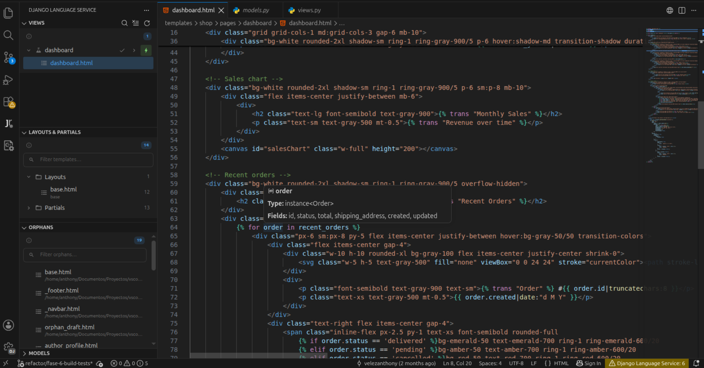
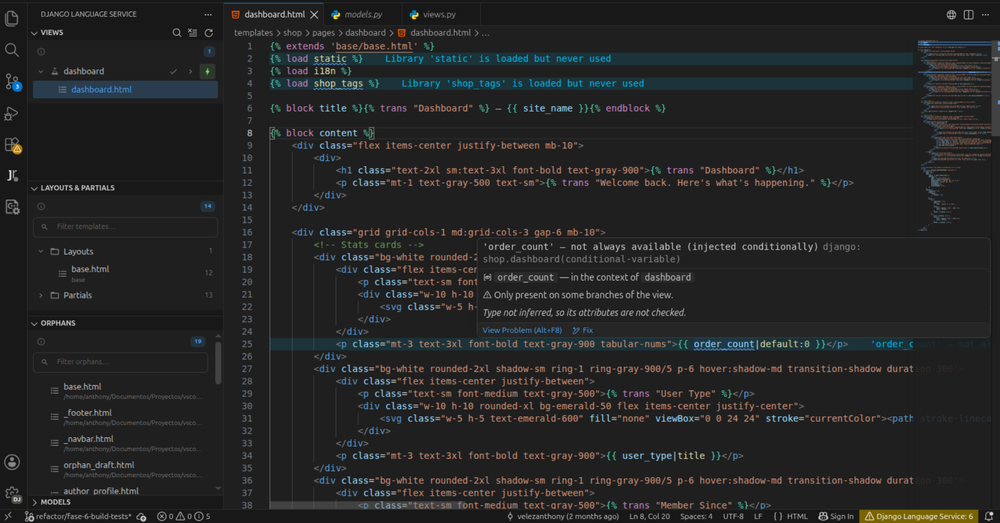
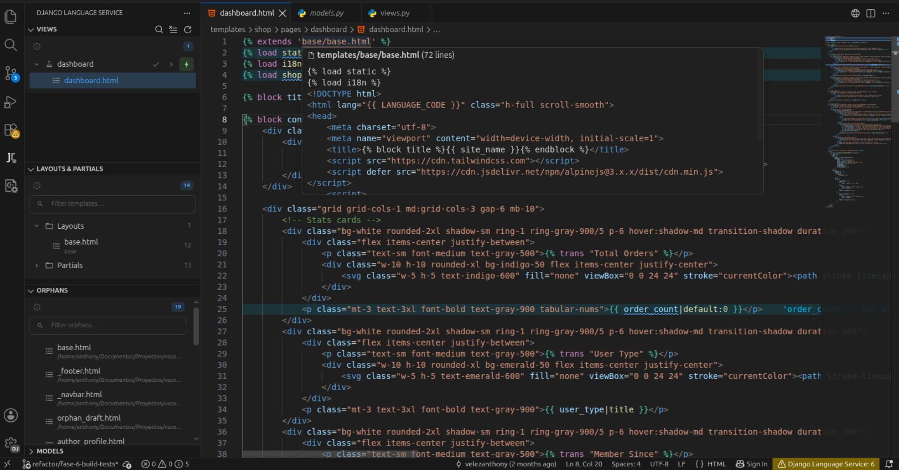

<div align="center">

# Django Language Service

**Django Template Language support that actually reads your project — plus an interactive ER diagram of your models.**

[](https://code.visualstudio.com/)
[](https://www.djangoproject.com/)
[](https://github.com/velezanthony/django-language-service/blob/main/LICENSE)



</div>

It is not a regex syntax plugin. On startup it parses your `models.py`, `views.py`, `forms.py`, `urls.py`, `templatetags/` and migrations into a project graph, keeps that graph warm with a scoped file watcher, and answers every completion, hover, go-to-definition and diagnostic from it.

That is the difference between _"`{{ }}` is highlighted"_ and _"`{{ order.customer.emial }}` — did you mean `email`?"_.

---

## Contents

- [Why](#why)
- [The model diagram](#the-model-diagram)
- [Template language support](#template-language-support)
- [IntelliSense](#intellisense)
- [Hover documentation](#hover-documentation)
- [Navigation](#navigation)
- [Diagnostics](#diagnostics)
- [Live Mode](#live-mode-view-aware-analysis)
- [Formatting](#formatting)
- [`` refactoring](#-include--refactoring)
- [Comments](#comments)
- [Sidebar explorer](#sidebar-explorer)
- [How it works](#how-it-works)
- [Reference: commands, settings, what gets indexed](docs/REFERENCE.md)

---

## Why

Django spreads one feature across four files. The view builds a context dict, the template consumes it, the model defines what those objects can do, and `urls.py` names the route. No editor sees the connection, so the mistakes land at runtime:

| You write                             | Django says, in the browser      | This extension says, as you type                           |
| ------------------------------------- | -------------------------------- | ---------------------------------------------------------- |
| `{{ product.nme }}`                   | nothing — renders empty          | `'nme' is not a field of Product — did you mean 'name'?`   |
| `{{ total }}`, never passed           | nothing — renders empty          | `'total' is not defined in the view context`               |
| ``           | `NoReverseMatch` at request time | `URL name 'produt_detail' is not defined in any urls.py`   |
| `{{ x\|money }}` without `` | `TemplateSyntaxError`            | `Filter 'money' requires ` + quick fix |

Silent empty output is the worst failure mode a template language has. Most of this extension exists to turn it into a squiggle.

---

## The model diagram

**Show Model Diagram** (`Ctrl+K Ctrl+D` / `Cmd+K Cmd+D`) opens a panel beside the editor that re-renders every time the scanner reports new data.

### Click a model to see what it touches

Selecting a box lifts it and its direct relations and dims everything else. The card is the model **as parsed**: real field types, `max_digits` / `decimal_places`, choices, `db_table`, forward relations, and every model that points back at this one. Click a relation to walk to it, or **Go to source** to open `models.py` at the class line.

Turn on **Blast radius (cascade delete)** in the _Analyze_ menu and clicking a model shows what a delete would `CASCADE` into instead — the question you actually want answered before writing `on_delete=models.CASCADE`.

### Walk your migration history

The migration panel replays your migrations as a chronological DAG. Pick a step and the canvas shows what that migration touched — added models in green, field changes in amber, removed models struck through.

The models a migration touched are rarely the whole story, so their **direct relation neighbours come along as muted context**, tagged `affected`. You see what changed _and_ what it lands on.

### Compare before and after

Click a model while a migration is selected and you get a field-level diff of that model across the step.

Two comparisons are available, and they answer different questions:

| Mode                 | Compares                         | Answers                         |
| -------------------- | -------------------------------- | ------------------------------- |
| **this migration**   | `snapshot[N-1]` → `snapshot[N]`  | what did this migration change? |
| **vs current state** | `snapshot[N]` → your live models | what has drifted since?         |

The diff compares the whole **field signature**, not just the type — a migration that only moves `DecimalField(10,2)` to `(12,4)` shows both columns with the changed kwarg highlighted, because the field type alone never changed.

Also in the panel: filters by relation type and app, a search box with `field:` and `rel:` scopes, circular-reference detection, hub-tier shading, live metrics, force-directed re-layout, saveable box positions, and full keyboard navigation.

### Exports that actually import

Copy the diagram as **Mermaid**, **DBML** (dbdiagram.io), **PlantUML** or raw **SVG**.

The output was checked against each format's own parser rather than eyeballed — `@dbml/core` parsed the DBML and converted it to PostgreSQL, `mermaid.parse` accepted the Mermaid, the PlantUML server rendered the PlantUML. That was a one-off validation, recorded in `diagram-exports.test.ts`. What CI runs on every push is a golden-output check, so it catches a regression against the last known-good export rather than against the upstream parsers. Concretely, the exports mean:

- Foreign keys emit the **real column** (`author_id`, or your `db_column`), typed after the key they point at, so every `Ref` resolves. A DBML file whose refs point at columns that do not exist is rejected outright by dbdiagram.
- `varchar(200)` and `decimal(12,2)` carry their length and precision.
- The implicit `id` appears only when Django would add one. An explicit or composite primary key replaces it, and `models.CompositePrimaryKey` becomes a table-level `indexes { (a, b) [pk] }`.
- `Meta.unique_together`, `Meta.indexes` and `UniqueConstraint` are rendered, each in the notation its format supports.
- `on_delete` becomes a DBML referential action.
- Abstract and proxy models are skipped — neither backs a table.

---

## Template language support

- **Syntax highlighting for DTL inside plain `.html` files** through a TextMate grammar injected into `text.html.basic` / `text.html.derivative`, so `{{ }}`, `` and `{# #}` are coloured without switching language mode. Dedicated grammars ship for `django-html` and `django-txt`.
- **Language configuration**: `{# #}` block comments, bracket pairs, auto-closing pairs that insert the trailing space (``), and onEnter rules that indent inside DTL blocks.
- **Folding** for any block tag the document closes — every `` in the file names its own opener, so ``, ``, ``, ``, `` and a tag library's own block tags all fold without a list to maintain.
- **Tag-pair highlighting** with correct depth counting. From a mid tag (``, ``) both the opener and closer light up.
- **Emmet is auto-configured** for `django-html` and `django-txt`.

---

## IntelliSense

All completions fire in `html`, `django-html` and `django-txt` unless stated otherwise.

- **Template paths** in `` / `` — and in Python near `render(`, `template_name`, `get_template(`.
- **URL names** in `` and in `reverse()` / `redirect()`, followed by the pattern's own path arguments.
- **Static files**, **DTL filters** (built-ins plus the loadable Django libraries the document's `` tags name — custom libraries from your own `templatetags/` are checked by the diagnostics, but do not yet appear in filter completion), and **block names** followed up the `` chain.
- **Context variables** — the view's context plus template-local bindings, resolving dotted chains hop by hop through the model graph. **Requires [Live Mode](#live-mode-view-aware-analysis).**
- **Python snippets** that key off the file you are in: `models.py` → `dm*`, `views.py` → `dv*`, `urls.py` → `du*`, and so on.

---

## Hover documentation

- **DTL tags and filters** — description, syntax, example, and a link to the Django docs. Most built-ins, plus ``, ``, ``, `|intcomma`, `|naturaltime`, `|ordinal` and Django 6.0's ``. A name the registry does not carry gets no hover at all, never a guessed one.
- **Template paths** preview the referenced file; **URL names** show the pattern and the view behind it.
- **Model fields** — hovering any segment of `{{ order.customer.email }}` says what that segment _is_: field, relation, `@property`, zero-argument method, annotation or dict key. **Requires Live Mode.**

---

## Navigation

Ctrl+Click a template path to open it, a URL name to reach its `path()`, or a context variable to land on the view that supplies it — `{{ product.name }}` goes to the model class that declares the field, following relations hop by hop. Template paths are clickable links everywhere they appear. Context-variable navigation **requires Live Mode**.

---

## Diagnostics

- **`` checking** (`django-dtl-load`) — a warning when a tag or filter needs a library that is not loaded, and a hint when a library is loaded but never used. Custom libraries are discovered from your `<app>/templatetags/*.py` modules — the library name is the module name, exactly as Django resolves it — and from `helpers.py` files.
  - Filters are found **wherever Django allows them**, including inside tag expressions (``), not only inside `{{ }}`.
  - A tag inside ``, `` or `{# #}` is not a use: it needs no load, and it does not keep an unused load alive.
  - **Quick fix**: `Add ` per library, plus an `Add all missing  tags` source-fix-all that works with fix-on-save.
- **URL references** — warns on names not defined in any `urls.py`, and bails out entirely when the index is empty so an incomplete scan never floods you.
- **Context variables** — variables not in the view's context, and dotted chains that do not resolve, with did-you-mean suggestions. **Requires Live Mode.**
- **Multi-line ``** hints, with a left-border decoration and ruler mark.
- **Script and style filter** — VS Code's own HTML validator reports garbage inside `<script>` blocks containing `{{ }}`. This strips DTL length-preservingly and reports only real JS and CSS errors. It writes two workspace settings; see [docs/REFERENCE.md](docs/REFERENCE.md).

### What it deliberately does not flag

A false warning is worse than no warning: it teaches you to ignore the squiggles. So the context checker knows that all of these are valid Django and stays quiet:

```django
{{ product.pk }}                     {# every model has it #}
{{ product.get_status_display }}     {# generated for any field with choices #}
{{ product.get_absolute_url }}       {# a zero-argument model method #}
{{ products.0.name }}                {# sequence index #}
  {# `as` binds a local #}
       {# so does blocktrans #}
{{ _("Hello") }}                     {# a call, not a variable #}
```

It still flags `{{ product.discounted }}` when `discounted` takes arguments — a template cannot call that — and `{{ ticket.id }}` when the model is keyed by something else.

And when it **cannot fully read** how a view builds its context — a `**spread` of something opaque, an `update()` with a value it cannot follow — it says so and drops to a note instead of accusing you:

> `'stats' was not found in the view context — the view builds it in a way this extension cannot read, so it may well be fine`

---

## Live Mode (view-aware analysis)



Context-variable completion, model-field hover, context go-to-definition and context diagnostics are **off until you pick a view**. That is deliberate: a template can be rendered by several views, so the extension refuses to guess.

Run **Pick View (Quick Pick)** from the Views sidebar, or toggle Live Mode there. **Live Mode belongs to the template you enabled it in** — open a different template and it switches off silently, because validating a document that view never renders would light up every variable in it. Switching to `views.py` and back keeps it on.

**Validate Context Variables** does a one-shot validation against a chosen view without turning Live Mode on.

### What it reads as "the context"

The context surface is read from the view body, whatever shape it takes:

```python
def dashboard(request):
    base = {"nav": nav_items()}
    ctx = {**base, "page": "dashboard"}      # merges expand
    ctx["title"] = "Dashboard"               # any variable name, not just `context`
    ctx.update(build_stats(request))         # helpers resolve, including imported ones
    return render(request, "dashboard.html", ctx)
```

Class-based views are followed too — `get_context_data`, `extra_context`, `model` / `context_object_name`, and **mixins defined in another file**, transitively.

---

## Formatting

Registered for `html`, `django-html` and `django-txt`, so **Format Document**, **Format on Save** and the extension's own command all go through it.

`<pre>` and `<textarea>` are emitted **verbatim** — their content preserves whitespace, so re-indenting them changes what the page renders. The opening tag is still indented, since that whitespace sits outside the element. `<script>` and `<style>` are the opposite case and stay reindented.

<table>
<tr><th align="left">Before</th><th align="left">After</th></tr>
<tr><td>

```html
<div>
  <pre>
 +---+
 |   |
 +---+
</pre>
</div>
```

</td><td>

```html
<div>
  <pre>
 +---+
 |   |
 +---+
</pre>
</div>
```

</td></tr>
</table>

## `` refactoring

- **Expand / collapse a single include** at the cursor — `Toggle HTML Props` switches between the two shapes, `Collapse to Inline` always collapses.
- **Expand All** / **Collapse All** across the document, with a count reported.
- **CodeLens** above every multi-line ``, and above single-line ones that carry HTML props.

## Comments

**Toggle Template Comment** (`Ctrl+Shift+/`, `Cmd+Shift+/`) toggles `{# #}` or `` over the selection, picking the right form for the selection shape.

---

## Sidebar explorer



Four sections, all driven by the project index and refreshed on every rescan:

- **Views** — for the open template, the views that can reach it and each one's template chain, with a ⚡ on the live view.
- **Layouts & Partials** — templates that others `` or ``, with counts.
- **Orphans** — templates no view renders and nothing includes.
- **Models** — totals, top apps, and models grouped by app; click one to open `models.py` at its class line.

<br clear="right">

### Debt signals in the workbench

- **Explorer badges**: a numeric badge for multi-line `` blocks (capped at `9+`), a `?` badge on orphan templates.
- **Status bar**: `Django Language Service: N`, broken down in the tooltip, hidden entirely at zero.

---

## Reference

Commands, keybindings, settings and exactly which files the indexer reads live
in **[docs/REFERENCE.md](docs/REFERENCE.md)**.

---

## How it works

On activation the extension builds a `Scanner` over a `FileSystem` port and an mtime-guarded parse cache, then runs two passes. **Pass 1** globs and parses every matched file into domain entities. **Pass 2** builds keyed indexes and resolves everything that crosses a file boundary: `` / `` targets, URL names, template chains, choice symbols imported from `enums.py`, abstract bases from `mixins.py`, `settings.AUTH_USER_MODEL`, and the context helpers and mixins a view pulls in. The result is a frozen `Project` snapshot; a new object identity per scan is what makes the downstream `WeakMap`-keyed memoization correct.

Pass 2 re-runs on every scan rather than being cached with the entity, which is what lets a cached view be _corrected_ instead of left stale when the file it depends on changes.

A file watcher — scoped to exactly the patterns above, never `**/*.py` — funnels events into a 200 ms debounce, evicts only the touched paths and re-runs both passes. Anything inside a virtualenv, `site-packages`, `node_modules` or `__pycache__` is filtered out before it reaches the debouncer, so `pip install` does not trigger a rescan.

The codebase is layered: `domain` is pure logic with zero `vscode` imports, `infra` owns I/O and indexing and depends only on `domain`, and `adapters` is the only layer that talks to the VS Code API. `extension.ts` is the single composition root, and each adapter registration is error-isolated so one broken provider cannot abort activation.

---

## Contributing

All of the documentation below is also published, searchable, at
**[velezanthony.github.io/django-language-service](https://velezanthony.github.io/django-language-service/)**.

- [`docs/ARCHITECTURE.md`](docs/ARCHITECTURE.md) — layer rules, the scan pipeline, the adapter contract.
- [`CONTRIBUTING.md`](CONTRIBUTING.md) — setup, conventions, pull-request workflow.

```bash
npm install
npm run watch              # esbuild watch (extension + webview bundles)
npm run check-types        # tsc --noEmit, both projects
npm run check-svelte       # svelte-check
npm test                   # vitest unit tests
npm run test:integration   # VS Code extension-host suite
npm run package            # type-check + svelte-check + lint + format check + unit tests + production CSS + bundle
```

Press <kbd>F5</kbd> to launch an Extension Development Host against the bundled test Django project.

Every image in this README is captured, never mocked up:

- The editor shots come from [`scripts/vscode-cdp-harness/`](https://github.com/velezanthony/django-language-service/blob/main/scripts/vscode-cdp-harness/README.md), which drives a real Extension Development Host over the Chrome DevTools Protocol — real VS Code, real theme tokens, real completion and diagnostic widgets.
- [`scripts/diagram-harness/`](https://github.com/velezanthony/django-language-service/blob/main/scripts/diagram-harness/README.md) does the same for the model diagram: it runs the shipped webview bundle in a plain browser against a payload parsed from the bundled test project.

Both recipes are committed, so the media can be regenerated after a UI change.

---

## License

[MIT](https://github.com/velezanthony/django-language-service/blob/main/LICENSE)
